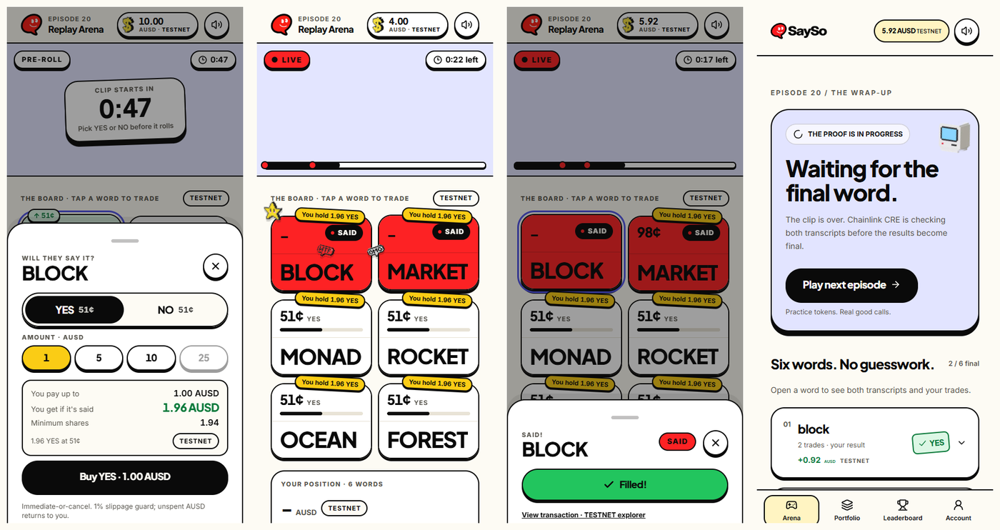
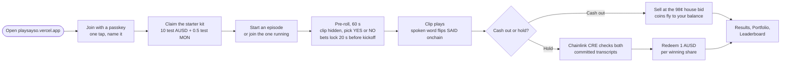
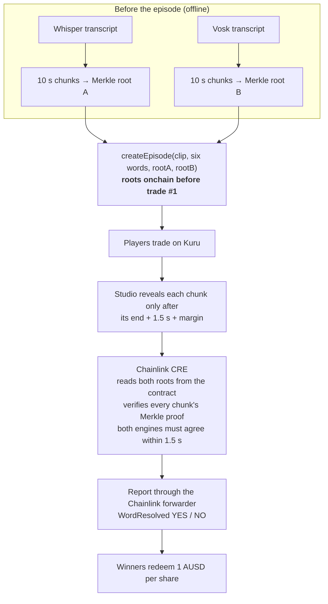
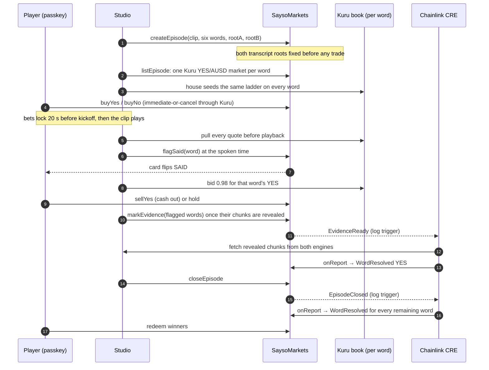
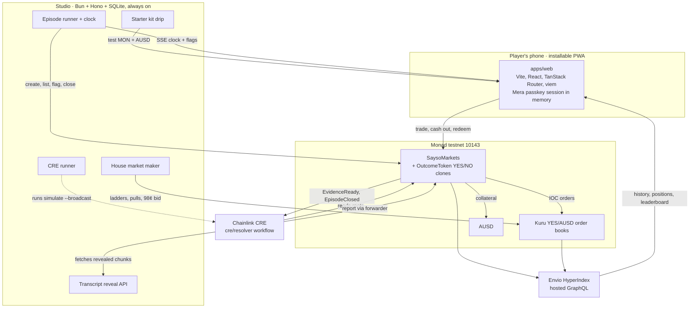

<p align="center">
  
</p>

<h1 align="center">SAYSO</h1>

<h3 align="center">Bet on the words before they're spoken.</h3>

<p align="center">
  Six words. One replayed clip. Every word is its own market on Monad.<br />
  The moment a word is spoken, its card flips <b>SAID</b> onchain in about a second, and Chainlink CRE settles it<br />
  from two transcripts that were locked onchain <b>before the first trade</b>. Not even we can change the answer.
</p>

<p align="center">
  <a href="https://playsayso.vercel.app"><b>Play it live</b></a> ·
  <a href="#for-judges-try-it-in-3-minutes">Judge brief</a> ·
  <a href="#how-a-round-plays">How it works</a> ·
  <a href="#architecture">Architecture</a> ·
  <a href="#sponsor-integrations">Sponsor integrations</a> ·
  <a href="#onchain-evidence">Onchain evidence</a>
</p>

<p align="center">
  
  
  
  
  
  
  
</p>

<p align="center">
  
</p>
<p align="center"><sub>A real round on Monad testnet, episode 20: pick before kickoff → the word is spoken and flips SAID → cash out → CRE settles.</sub></p>

---

## SAYSO in numbers

Everything below happened on Monad testnet and is readable onchain or through the public indexer. Snapshot taken 11 October 2026.

| | |
|---|---|
| **12** episodes played and settled end to end | episodes 12 to 23, every one by Chainlink CRE |
| **72** word markets resolved | 26 YES, 46 NO, zero admin overrides |
| **34** CRE workflow runs succeeded | 23 evidence reports and 11 close reports, 5 to 33 s each |
| **65** player trades from **13** wallets | team and early testers; 78 positions redeemed for AUSD |
| **455 to 1,257 ms** | spoken word to mined `flagSaid`, measured on episodes 12, 21 and 22 |
| **1 tap** | passkey sign-up; no wallet app, no seed phrase, no extension |

## The problem

Millions of people watch casters, streamers and finals, and the only thing they can do is watch.

The appetite to play along is already real. Traders staked [more than $47 million on what NFL announcers would say in a single season](https://awfulannouncing.com/nfl/kalshi-more-than-47-million-announcer-mention-markets.html), and Kalshi plus Polymarket traded [$53 billion in July 2026 alone, double May](https://www.pewresearch.org/short-reads/2026/09/23/prediction-markets-trading-volume-doubled-between-may-and-july-largely-driven-by-sports). But "mention markets" have three problems:

1. **They settle after the fact, by trust.** Someone reads a transcript after the event and declares the result. Players cannot check the answer key, and the operator could change it. In August 2026 Kalshi [pulled sports mention markets amid a federal inquiry](https://awfulannouncing.com/prediction-markets/kalshi-ceases-offering-sports-mention.html).
2. **They are not a game.** You place a bet and wait hours. Nothing happens while you watch.
3. **They start with a wallet.** Seed phrases, extensions and gas lose most people before their first call.

## What SAYSO does

SAYSO turns a replayed clip into a short, fair, fast game show.

| | A mention market today | SAYSO |
|---|---|---|
| When it settles | Hours or days later | SAID flips onchain about a second after the word; CRE finalizes every word within seconds of the clip ending |
| Who decides the answer | Whoever reads the transcript | Two independent transcripts (Whisper and Vosk) committed onchain as Merkle roots before trading; Chainlink CRE verifies the proofs |
| Can the house change it | Trust us | No. Only the CRE forwarder can settle; the owner can only void a word 24 h after close if no report ever arrived |
| What you do while watching | Nothing | Watch cards flip SAID live, cash out at 98¢ or hold for 1 AUSD |
| How you sign up | Wallet, seed phrase, extension | One passkey tap with Mera; every later move signs silently |
| Money | Real, regulated | **TESTNET only**: free test AUSD, no fees, no real money |

**Why build it.** "Earning while watching what you enjoy? That would be nice. So I'm building it." The bet behind SAYSO is that the next big consumer crypto app is a game you play with friends during a stream, and that it only works if the result is provably fair and the onboarding is invisible. Monad makes the first part feel live; Chainlink CRE and Mera make the other two real.

## How a round plays



A full round takes about three minutes: 60 s of pre-roll, a 32 to 54 s clip, then CRE settlement in seconds. Every balance, price and payout is labelled TESTNET.

## Fair by construction

The answer key is locked before anyone can trade, and the only thing allowed to read it out is Chainlink CRE.



| Actor | Can | Cannot |
|---|---|---|
| Operator (studio) | Pick the clip and words before trading, flag SAID, mark evidence, close | Change a transcript after commit, settle a word, touch collateral |
| Chainlink CRE | Report outcomes through the forwarder | Settle without valid proofs against both onchain roots |
| House market maker | Quote the same ladder on every word before playback, bid 98¢ for YES once a word is flagged | Quote from transcript knowledge; the 98¢ bid is disclosed in the app |
| Owner | Switch the forwarder from simulation to the DON, void a word 24 h after close with no report | Withdraw collateral or settle a word |
| Player | Immediate-or-cancel orders only, redeem winners | Rest orders on the book |

If a proof fails or the two engines disagree, CRE sends no report and the market stays open. It never guesses.

## How one episode works onchain



## Why Monad

- **SAID has to feel live.** Monad's roughly 400 ms blocks let the studio mine `flagSaid` inside the 1.5 s presentation delay, so a SAID card is backed by a mined transaction, not a server promise. Measured spoken-to-mined latency: 455 to 1,257 ms.
- **A market per word, per episode.** Each episode deploys six fresh Kuru YES/AUSD books. Cheap creation and matching make that practical; on most chains it would not be.
- **Gas is explicit.** Monad bills the gas limit, so every transaction carries a measured limit from one table ([`packages/core/src/gas.ts`](packages/core/src/gas.ts)) and each sender waits for the next block before sending again.

## Architecture



**Rules that shaped it**

- **Chain is truth.** Balances, prices and outcomes are read from the chain. Envio and the studio's SQLite are read models; nothing a player owns lives only off chain.
- **Outcomes never leak.** Clip manifests, transcripts and flag plans are private studio data, never in git. Chunks reveal on a clock, after the moment they describe.
- **Keys never leave memory.** The passkey's PRF output derives the signing key inside a Mera session; it is never written to storage or sent to a server.
- **One matcher.** Studio, CRE and the web share one pure word matcher, chunker and Merkle implementation in [`packages/core`](packages/core), so all three always agree on what "said" means.

| Path | What lives there |
|---|---|
| [`contracts`](contracts) | `SaysoMarkets`, `OutcomeToken`, `KuruTrade`; Foundry unit, invariant and fork tests |
| [`cre/resolver`](cre/resolver) | Chainlink CRE workflow: two log triggers, proof checks, report |
| [`apps/web`](apps/web) | PWA: landing, Arena, live episode, Results, Portfolio, Leaderboard, Account; voxel art and sound |
| [`apps/studio`](apps/studio) | Scheduler, episode clock, flags, house market maker, starter kit, reveal API, CRE runner, health |
| [`indexer`](indexer) | Envio HyperIndex config, schema and handlers |
| [`packages/core`](packages/core) | Matcher, chunking, Merkle, units, gas table, vendored ABIs; pure, no I/O |
| [`tools/transcribe`](tools/transcribe) | Offline two-engine transcription (whisper.cpp + Vosk), chunks and roots |
| [`tools/sfx`](tools/sfx) | Offline sound effect generation and loudness mastering |
| [`docs`](docs) | [PRD](docs/PRD.md), [DESIGN](docs/DESIGN.md), [ARCHITECTURE](docs/technical/ARCHITECTURE.md), [SMART-CONTRACTS](docs/technical/SMART-CONTRACTS.md), [INTEGRATIONS](docs/technical/INTEGRATIONS.md), [BUILD-PLAN](docs/technical/BUILD-PLAN.md), [LESSONS](docs/LESSONS.md) |

## Sponsor integrations

### Chainlink CRE: the only thing that can settle a word

The workflow in [`cre/resolver/src`](cre/resolver/src) has two EVM log triggers. `EvidenceReady` fires when flagged words have their chunks revealed: CRE reads `rootA` and `rootB` from the contract, fetches the revealed chunks over HTTP, verifies each Merkle proof, requires both engines to place the word within 1,500 ms, and sends a `WordResolved YES` report. `EpisodeClosed` checks both complete transcripts and resolves every remaining word (spoken late is YES, never spoken is NO). `SaysoMarkets._processReport` accepts reports only from the Chainlink forwarder. There is no admin settle function.

**Mode, stated plainly:** reports run through `cre workflow simulate --broadcast` against the Chainlink simulation forwarder on Monad testnet, triggered automatically by the studio for every episode. DON deploy access has been requested and is not enabled yet, so we do not claim a live DON deployment. Switching is three owner calls documented in [SMART-CONTRACTS](docs/technical/SMART-CONTRACTS.md).

### Mera: the whole account layer

No wallet extension, seed phrase, email login or custody backend. A player taps "Join with passkey" (and can name the passkey so they find it later); Mera derives a secp256k1 key from the passkey's PRF output inside a signing session that lives only in memory. After that one tap, buys, cash-outs and redeems sign without prompts through a block-sequenced queue with explicit gas. If the session ends mid-action, the app asks for one tap and accepts only the same address. Clearing all site data and signing in again restores the same address, balance and positions, because they live onchain. Code: [`apps/web/src/account`](apps/web/src/account).

### Envio: history and rankings

HyperIndex on Envio Cloud indexes `SaysoMarkets` and the Kuru books through HyperSync: episodes, words, trades, SAID flags, CRE resolutions and redemptions. Handlers derive `Position`, `Player` and per-episode rankings, and profit only counts words CRE has already resolved, so an open position can never move anyone up the board. The Leaderboard, Portfolio history, Results and the Arena's recent rounds read it over GraphQL. Code: [`indexer`](indexer). Endpoint: `https://indexer.dev.hyperindex.xyz/0c56fbe/v1/graphql`.

### Kuru: one order book per spoken word

`listEpisode` deploys one Kuru YES/AUSD market per word through `Router.deployProxy`. The house seeds every book with the same flip-order ladder before playback, pulls all quotes before the clip starts, and posts a disclosed 98¢ bid on a word the moment it is flagged. Players trade immediate-or-cancel through `SaysoMarkets` (`placeAndExecuteMarketBuy/Sell`); a NO position is a complete set with the YES side sold into the book. Code: [`contracts/src/KuruTrade.sol`](contracts/src/KuruTrade.sol), [`apps/studio`](apps/studio).

### AUSD: the unit of the game

Every word is collateralized in AUSD: 1 AUSD mints one YES plus one NO, the winner redeems 1 AUSD. AUSD's ERC-2612 permit lets a player approve once. Players receive free test AUSD in their starter kit.

## Onchain evidence

All public on Monad testnet (chain `10143`). Explorer: [testnet.monadvision.com](https://testnet.monadvision.com). Every address was checked with `cast code` before it entered the code.

### Contracts

| Contract | Address |
|---|---|
| `SaysoMarkets` | [`0xc8492B2906d57c184be372899d18EDF195D11CF8`](https://testnet.monadvision.com/address/0xc8492B2906d57c184be372899d18EDF195D11CF8) · source verified (Sourcify exact match, Monadscan) |
| `OutcomeToken` implementation | [`0xC0688e3810d79407cc65EbE1910AC57f6dcCcC6b`](https://testnet.monadvision.com/address/0xC0688e3810d79407cc65EbE1910AC57f6dcCcC6b) · source verified |
| Chainlink CRE simulation forwarder | [`0xB9F79d863261869B234c481D1f9A7af84AeAd192`](https://testnet.monadvision.com/address/0xB9F79d863261869B234c481D1f9A7af84AeAd192) |
| AUSD (testnet) | [`0xa9012a055bd4e0eDfF8Ce09f960291C09D5322dC`](https://testnet.monadvision.com/address/0xa9012a055bd4e0eDfF8Ce09f960291C09D5322dC) |
| Kuru Router | [`0x7EFbE105Ca7415dE98F96622173458ac1c054630`](https://testnet.monadvision.com/address/0x7EFbE105Ca7415dE98F96622173458ac1c054630) |
| Kuru MarginAccount | [`0xd029C2D98ff85D8F64799017fE00a59B1159CE02`](https://testnet.monadvision.com/address/0xd029C2D98ff85D8F64799017fE00a59B1159CE02) |

### One episode, transaction by transaction (episode 22, "olympic-pool-1964")

| # | Step | Signed by | Block | Transaction |
|---|---|---|---|---|
| 1 | `createEpisode`: six words, both transcript roots committed | Operator | 70,066,947 | [`0x2f04…f85b`](https://testnet.monadvision.com/tx/0x2f045ee41da8e6009b0c89fb8703b37990cbe0bbe508023162383173814af85b) |
| 2 | `flagSaid` "butterfly", 585 ms after it was spoken | Operator | 70,067,192 | [`0x353d…a6fc`](https://testnet.monadvision.com/tx/0x353d64580d07fdbe22c88a9b0782503758bead7020c2e2632a5a1186d18ea6fc) |
| 3 | **CRE evidence report → `WordResolved` YES** | **Chainlink CRE** | 70,067,247 | [`0xb890…cfea4`](https://testnet.monadvision.com/tx/0xb89006abecf77dd078ab0236ec828e32fa71a37ae42bb87f5bc263afb72cfea4) |
| 4 | `closeEpisode` | Operator | 70,067,334 | [`0x5843…4a8a`](https://testnet.monadvision.com/tx/0x5843206865205638d89fe4146ac5a1a3c8b5e93541f324a610d6947105eb4a8a) |
| 5 | **CRE close report → three decoys NO, episode Settled** | **Chainlink CRE** | 70,067,364 | [`0xece2…8962`](https://testnet.monadvision.com/tx/0xece2f9453716ce15f284b14dca7ba82a0b19e452120ff49118c9ba321b778962) |

### A player's money, end to end

| Step | Episode | Transaction |
|---|---|---|
| Buy 1.96 YES for 1 AUSD on Kuru | 11 | [`0x03d1…a499`](https://testnet.monadvision.com/tx/0x03d14b142f6f22f1dc25cdb65260e841debdff7bb0852a8f895968c34da3a499) |
| Cash out after SAID into the 98¢ bid | 11 | [`0x8327…1eb8`](https://testnet.monadvision.com/tx/0x8327ccc2ba13368bdc6d13e2010c2948fa0cd07aa74c47397355f5f0ab461eb8) |
| First CRE report ever settled on SAYSO | 12 | [`0x216b…2348`](https://testnet.monadvision.com/tx/0x216b9f1434c1239ed03f68eb2cb6fc30d4c704c90b98712434c7b681195e2348) |
| Redeem a winning word for AUSD | 20 | [`0x5871…091d`](https://testnet.monadvision.com/tx/0x58717f5b049dad52da0bbd27e46dd025e9d0e58fc74825dd30cbbb91bf78091d) |

[SMART-CONTRACTS](docs/technical/SMART-CONTRACTS.md) has the deployment log, the gas table and the invariants. [INTEGRATIONS](docs/technical/INTEGRATIONS.md) has every external fact with its source.

## For judges: try it in 3 minutes

1. **Use a phone.** Android Chrome or iOS Safari, on [playsayso.vercel.app](https://playsayso.vercel.app). Desktop browsers whose passkeys live in a local profile often lack the PRF extension Mera needs; the app says so instead of failing. Optional: tap **Install app** on the landing page.
2. **Play → Join with passkey.** Give the passkey a name you will recognise, then confirm with your fingerprint, face or PIN.
3. **Arena → Claim starter kit.** You get 10 test AUSD and 0.5 test MON, once per account.
4. **Start an episode** (or join the one already running). Pick YES or NO on any of the six words during the 60 s pre-roll; bets lock 20 s before kickoff.
5. **Watch the board.** Spoken words flip SAID. Cash out at 98¢ or hold.
6. **Results.** Chainlink CRE settles every word within seconds of the clip ending. Tap **Redeem AUSD** for winners, then check Portfolio and the Leaderboard.
7. **Account → Sign out**, then **I already have one**: the same passkey brings back the same address and positions.

**Fair-use limits, so the game stays free for everyone**

| Limit | Why |
|---|---|
| One episode runs at a time for everyone | If an episode is already running, join it instead of starting one |
| One "Start an episode" per network (IP) per hour | Each episode costs about 1.6 testnet MON in gas; this keeps the house solvent through judging |
| One starter kit per account, and one new account per network per hour | Protects the test-token faucet. On shared Wi-Fi with another judge, use mobile data |
| Six rights-cleared clips rotate, least recently played first | After a clip is played its outcomes are public onchain, so a returning judge gets a different clip |

The studio, indexer and web app stay up through the whole judging period. If something looks stuck, the studio health endpoint is public: [`/v1/health`](https://sayso-studio.43-129-38-115.nip.io/v1/health).

## Where SAYSO stands

An honest snapshot, not a launch announcement. Full task-by-task proof is in [BUILD-PLAN](docs/technical/BUILD-PLAN.md); open external gates are in [BLOCKERS](docs/BLOCKERS.md).

| Area | Status |
|---|---|
| Contracts | Deployed on Monad testnet, source verified; Foundry unit, invariant and fork tests |
| Live episodes | 12 consecutive episodes created, played and settled by CRE without manual settlement |
| CRE settlement | Running in simulation mode through the official CLI for every episode; DON deploy access requested |
| Passkey accounts | Join, sign out, restore the same address: proven in Edge with a PRF authenticator and on the founder's Android phone, including a redeem after signing back in. iOS not yet tested on a real device |
| Web | Live at [playsayso.vercel.app](https://playsayso.vercel.app), installable PWA, every screen checked at a 412 px phone viewport |
| Indexer | Live on Envio Cloud; leaderboard profit reconciled against onchain cashflows |
| Clip library | 6 clips: one original test clip and five public-domain Universal Newsreel cuts (1957 to 1964) |
| Audit | Not audited. Testnet only |

## Roadmap

SAYSO is not a hackathon throwaway. We are committing to it beyond Metropolis, and we would welcome every bit of support the Monad ecosystem can offer: mentorship, grants, introductions to creators and esports leagues, and early users.

| Stage | What ships |
|---|---|
| **Now: the fair loop** | Replay Arena, six words per clip, SAID onchain, CRE settlement, passkey accounts, free test AUSD |
| **Next: creators run it** | An operator console so a creator can upload a clip, pick six words and launch an episode without us (the top ask from our first testers); CRE on the DON |
| **Then: the right content** | Licensed esports and creator commentary, starting with Southeast Asian Mobile Legends fans (MPL Indonesia S17's final [peaked at 2.9M viewers](https://escharts.com/news/mpl-indonesia-season-17-recap)); Indonesian-language transcription |
| **Then: the business** | Free-to-play seasons with sponsors: a brand sponsors a word, creators earn a share of what their audience plays. White-label word markets for streaming platforms |
| **Later, only where legal** | Real-money markets with trading fees, only in jurisdictions that allow them and after an audit. Until then SAYSO stays free to play |

## Run it locally

Requirements: Bun 1.3.14, Node 24.21+, Foundry. The Envio CLI needs Linux or macOS (WSL on Windows).

```sh
bun install
cp .env.example .env                 # fill locally; never commit values
(cd contracts && forge soldeer install && forge test)
bun run verify                       # typecheck, Biome and Vitest across every workspace
bun run --cwd apps/web dev           # http://localhost:5173
```

The studio needs testnet role keys and a data directory outside the repo. That directory holds clip media, both transcripts and the flag plan, so outcomes never enter git:

```sh
bun --env-file=<studio.env> apps/studio/src/main.ts   # RPC_URL, CHAIN_ID=10143, STUDIO_DATA_DIR, role keys
```

Transcribe a new clip with both engines (`bun run --cwd tools/transcribe transcribe -- --help`) and run the resolver yourself with `cre workflow simulate . --target monad-testnet` in `cre/resolver`. Deployment of the studio is in [`deploy/studio.runbook.md`](deploy/studio.runbook.md).

## Built with AI, piloted by a human

SAYSO was built by one person, **[Febri Nirwana](https://github.com/febrinirwana)**, a smart contract engineer and ETHOnline 2026 winner with [Mandate](https://github.com/febrinirwana/mandate), working with AI coding agents. Development commits begin on 5 October 2026.

**The human decided.** Product, game rules, the fairness model, every design approval, which risks to accept, every deployment and every commit. All testnet keys stayed with the human; no agent was given wallet authority beyond the studio's own testnet role keys.

**The agents executed.** Anthropic Claude and OpenAI GPT coding agents, run through omp, wrote and refactored code, ran tests, drafted documentation and checked onchain state, always under explicit instructions and review.

**What they were told is in the repo.** [`CLAUDE.md`](CLAUDE.md) is the operating contract (fairness rules, testnet only, chain is truth, never leak an outcome); [`.claude/skills`](.claude/skills) holds the project skills for matching, markets, CRE and passkeys; [`docs/technical/BUILD-PLAN.md`](docs/technical/BUILD-PLAN.md) lists every task with the proof it needed; [`docs/LESSONS.md`](docs/LESSONS.md) records every verified mistake and the rule it produced. AI output was treated as untrusted until a test, a receipt or a rendered screen confirmed it.

**Third-party work, credited.**

- Vendored code: Chainlink `ReceiverTemplate`/`IReceiver` ([`contracts/src/vendor/chainlink`](contracts/src/vendor/chainlink)), OpenZeppelin and forge-std (pinned through Soldeer), Kuru interfaces and ABIs from the published SDK.
- Clips: Universal Newsreel films from the [Internet Archive](https://archive.org), public domain; one original test clip.
- Speech models: whisper.cpp `ggml-base.en` and Vosk `vosk-model-en-us-0.22`, run offline.
- Sound effects: generated with [elevenlabs.io](https://elevenlabs.io) and mastered with ffmpeg.
- Visuals: the logo and voxel artwork were supplied by the developer; some decorative voxel mesh work was adapted from an earlier project of his.

## Disclaimer

SAYSO is a hackathon project in active development and has not been audited. It runs on Monad testnet only, with test tokens that have no monetary value. There are no fees and no real money. Nothing here is financial or betting advice.

<p align="center">
  <br />
  <b>Say it before they say it.</b><br />
  <sub>Built for Monad Metropolis 2026 · Monad · Chainlink CRE · Mera · Envio · Kuru · AUSD</sub><br />
  <sub><a href="LICENSE">MIT</a> © 2026 Febri Nirwana</sub>
</p>
